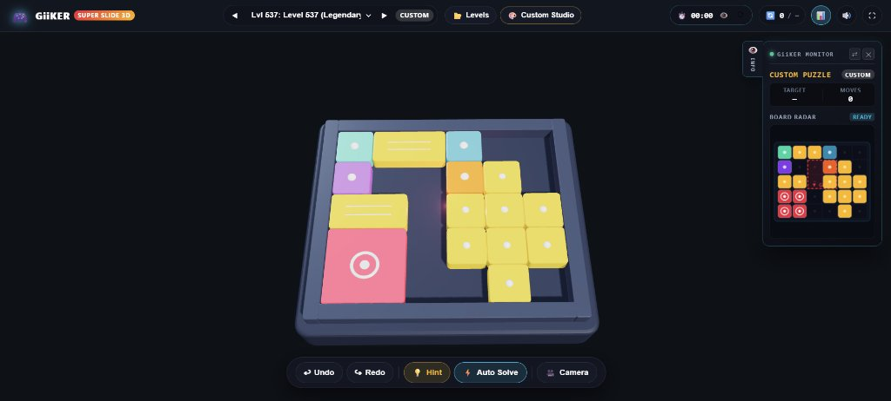

# GiiKER Super Slide 3D 🎮🧩

A premium, tactile, colorful 3D web puzzle game inspired by the famous **GiiKER Super Slide** electronic smart sliding board game and classic **Klotski / Huarong Dao** brain teasers.

[](https://diptarkasamanta.github.io/Giiker-Super-Slide-3d/)
[](https://threejs.org/)
[](start_game.bat)



## 🌐 Play Online in Your Browser

You can play GiiKER Super Slide 3D directly in your browser without installing anything:  
👉 **[https://diptarkasamanta.github.io/Giiker-Super-Slide-3d/](https://diptarkasamanta.github.io/Giiker-Super-Slide-3d/)**

---

## ⚡ Quick Start (Windows)

Just double-click **`start_game.bat`** in the project folder! It will automatically launch the local game server and open the game in your default web browser.

---

## ✨ Features

- **True 3D Tactile Console Aesthetics**:
  - Realistic handheld electronic console chassis with rounded matte casing, recessed playfield tray, and beveled sockets.
  - Glossy, clearcoat candy-lacquered sliding blocks modeled in Three.js (`MeshPhysicalMaterial`) with beveled edges, realistic specular reflections, and soft drop shadows.
  - Symmetrical, balanced 3D console body centered on the playing field.
- **Bold 3D Neon Goal Lines & Reticles**:
  - Raised luminous neon goal rails framing the goal destination on the board floor.
  - **Escape Gate Finish Line**: Dedicated glowing finish line across the escape threshold.
  - **Aiming Reticles & Goal Posts**: High-contrast L-bracket corner caps and vertical wall goal posts flanking the escape notch.
  - **Color Highlights**: Choose between **Duo (Red + Green)**, **Laser Green**, or **Cyber Red** highlight modes (toggle anytime with <kbd>G</kbd>).
- **Retractable Side Level Monitor HUD**:
  - Futuristic floating cyber-monitor card docked on the side of the screen.
  - Shows formatted level ID / custom title, difficulty badge, target moves, live moves, and a real-time 2D mini dot-matrix board radar.
  - **Quick Hide / Invisible Button**: Click the subtle eye icon (`👁️`) tab, the close `✕` button on the panel, the `📊` header button, or press <kbd>I</kbd> to collapse it completely out of the way for distraction-free gameplay.
  - **Dock Switcher (`⇄`)**: Easily flip between right-docked and left-docked layout based on personal preference.
- **550+ Curated & Verified Levels**:
  - **Starter Pack (Levels 1 – 100)**: 3 to 15 moves, learning piece clearing and corner routing.
  - **Learner Pack (Levels 101 – 200)**: 16 to 25 moves, expanding intermediate maneuvers.
  - **Intermediate Pack (Levels 201 – 310)**: 26 to 40 moves, tight corridor pathfinding.
  - **Advanced Pack (Levels 311 – 420)**: 41 to 65 moves, multi-phase spatial planning.
  - **Master Pack (Levels 421 – 500)**: 66 to 85 moves, complex sliding configurations.
  - **Legendary & Famous Klotski Pack (Levels 501 – 550)**: Including the world-famous *Heng Dao Li Ma (116 steps)*, *Command of Five Generals*, *Escorting the Emperor*, *Swallow's Wings*, and *Seven Stars and the Moon*.
- **Custom Studio Mode (🎨)**:
  - **Custom Board Dimensions**: Configure board width (3 to 8 columns) and height (3 to 8 rows).
  - **Custom Goal Exit Target**: Set exit to Bottom-Center, Bottom-Left, Top-Center, or click any cell on the grid.
  - **Custom Piece Forge**: Build custom polyomino dimensions (up to 4×4), pick any color from the spectrum, and mark as goal or immovable barrier.
  - **Interactive 2D Grid Canvas**: Click to place pieces, remove pieces with '×', and view live statistics of filled vs empty cells.
  - **In-Browser BFS Solvability Checker**: Verifies 100% solvability and calculates optimal move count in milliseconds.
  - **Instant Play, Save & Export**: Test & play your custom creations in 3D right away, save to local browser storage, and export/import JSON to share!
- **Interactive Controls (Mobile & Laptop / Desktop)**:
  - **Smooth 3D Drag & Snap**: Click or touch and drag pieces smoothly along orthogonal grid channels with real-time collision boundaries.
  - **Smart Tap-to-Slide**: Click or tap any piece to immediately slide it into adjacent open space for lightning-fast speedsolving!
  - **Keyboard Support**: Arrow keys or <kbd>W</kbd><kbd>A</kbd><kbd>S</kbd><kbd>D</kbd> to slide pieces, <kbd>Tab</kbd> to select pieces, <kbd>Z</kbd> for Undo, <kbd>Y</kbd> for Redo, <kbd>R</kbd> for Reset, <kbd>H</kbd> for Hint, <kbd>G</kbd> for Goal Highlight Color, <kbd>I</kbd> for Info Monitor visibility, <kbd>T</kbd> for Timer visibility, <kbd>Space</kbd> for Camera preset.
  - **3D Camera Orbit & Presets**: Right-click + drag to orbit in 3D; quick camera buttons for *Handheld Angle*, *Top-Down Flat*, and *Isometric 3D*.
- **Timer HUD with Quick Hide & Restart**:
  - High-precision digital timer (`MM:SS`).
  - **Eye Button (👁️ / 🙈)** or <kbd>T</kbd> key: Instantly hides or shows the timer for stress-free casual solving!
  - **Restart Button (⟳)** or <kbd>R</kbd> key: Instantly resets the timer to 00:00 and restores the board to the initial level layout.
- **Built-in AI Solver & Hints**:
  - **Hint (💡)**: Solves from current layout and animates 1 optimal step forward.
  - **Auto-Solve (⚡)**: Plays through the remaining solution step-by-step with pause/resume support.
  - **Undo / Redo (↩ / ↪)**: Full move history stack.
- **Tactile Procedural Audio Engine**:
  - Built with the Web Audio API — zero external sound files!
  - Plastic sliding whoosh, crisp magnetic snap clack, button click, level beep, hint arpeggio, and celebratory victory fanfare.
- **Responsive Mobile & Desktop Design**:
  - Touch-optimized with `touch-action: none` to prevent screen dragging or pull-to-refresh while sliding blocks.
  - Fits mobile portrait/landscape, laptops, tablets, and desktop displays.

---

## 🕹️ Controls Guide

| Action | Control |
| :--- | :--- |
| **Drag Piece** | Click / Touch & drag in direction of empty space |
| **Quick Tap-to-Slide** | Click / Tap piece once to slide into adjacent empty space |
| **Slide with Keyboard** | <kbd>←</kbd> <kbd>→</kbd> <kbd>↑</kbd> <kbd>↓</kbd> or <kbd>W</kbd> <kbd>A</kbd> <kbd>S</kbd> <kbd>D</kbd> |
| **Undo / Redo** | <kbd>Ctrl</kbd>+<kbd>Z</kbd> / <kbd>Ctrl</kbd>+<kbd>Y</kbd> or toolbar buttons |
| **Restart Level & Timer** | <kbd>R</kbd> key or ⟳ button |
| **Toggle Timer Visibility** | <kbd>T</kbd> key or 👁️ eye button |
| **Toggle Level Info Monitor** | <kbd>I</kbd> / <kbd>M</kbd> key, 👁️ side tab, or 📊 header button |
| **Switch Monitor Dock (L/R)** | ⇄ button on Side Monitor card |
| **Cycle Goal Line Highlight** | <kbd>G</kbd> key or 🎯 button on Side Monitor (Duo / Green / Red) |
| **1-Step Hint** | <kbd>H</kbd> key or 💡 Hint button |
| **Auto Solve** | ⚡ Auto Solve button |
| **Cycle Camera Preset** | <kbd>Space</kbd> key or 🎥 Camera button |
| **Orbit Camera** | Right-click + drag on canvas (or two-finger drag on mobile) |
| **Zoom** | Mouse scroll wheel |

---

## 🚀 Running Locally

### Option 1: Double Click `start_game.bat` (Windows)
Double-click `start_game.bat` to launch automatically in your browser.

### Option 2: Python HTTP Server
```bash
python -m http.server 8080
```
Then navigate to `http://localhost:8080`.

### Option 3: Node.js / npx
```bash
npx serve .
```

---

## 📡 Publishing to GitHub Pages

This repository includes an automatic GitHub Actions deployment workflow ([.github/workflows/pages.yml](.github/workflows/pages.yml)).

To activate:
1. Go to your repository on GitHub: **`https://github.com/DiptarkaSamanta/Giiker-Super-Slide-3d`**
2. Click **Settings** ⚙️ > **Pages** (in the left sidebar).
3. Under **Build and deployment** > **Source**, select **GitHub Actions** (or select **Deploy from a branch** and choose `main` / `root`).
4. Once selected, your game is live and playable at:  
   👉 **`https://diptarkasamanta.github.io/Giiker-Super-Slide-3d/`**

---

## 📂 Project Structure

```
D:\projects\Giiker super slides\
├── index.html              # Main HTML markup & UI modals
├── index.css               # Styling, animations & responsive layout
├── screenshot.jpg          # In-game preview screenshot
├── three.min.js            # Three.js 3D WebGL engine (offline)
├── OrbitControls.js        # Three.js camera controller (offline)
├── confetti.browser.min.js # Confetti celebration engine (offline)
├── start_game.bat          # 1-click launcher for Windows
├── README.md               # Documentation & controls guide
├── .github/
│   └── workflows/
│       └── pages.yml       # Automated GitHub Pages CI/CD deployment
└── src/
    ├── audio.js            # Procedural Web Audio sound effects
    ├── levels_data.js      # 550+ verified, curated levels
    ├── solver.js           # Real-time BFS solver, validator & hint generator
    ├── custom_studio.js    # Custom board dimensions, custom piece builder & presets
    └── game.js             # Three.js 3D engine, piece dragging physics & HUD
```

---

## 🛠️ Tech Stack

- **Graphics**: [Three.js](https://threejs.org/) (WebGL 3D engine with soft shadow maps and physical materials)
- **Controls**: `OrbitControls.js`
- **Effects**: `canvas-confetti`
- **Audio**: Web Audio API procedural synthesizer
- **Styling**: Vanilla CSS with cyber handheld console design system
- **Algorithms**: Breadth-First Search (BFS) state space solver & Bitboard hashing
